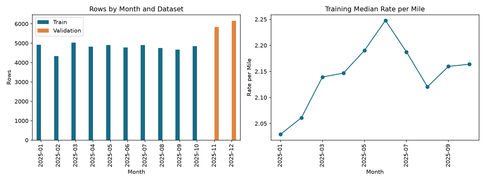
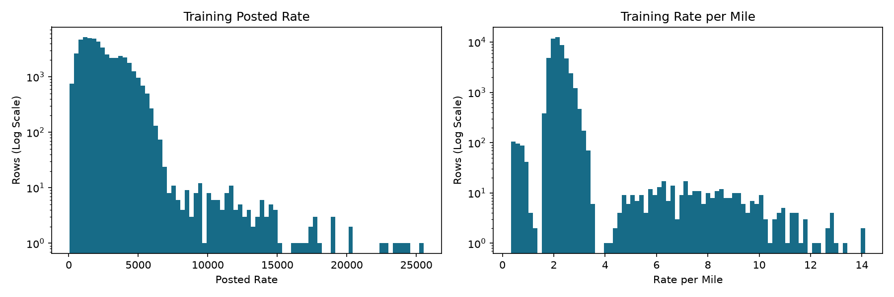
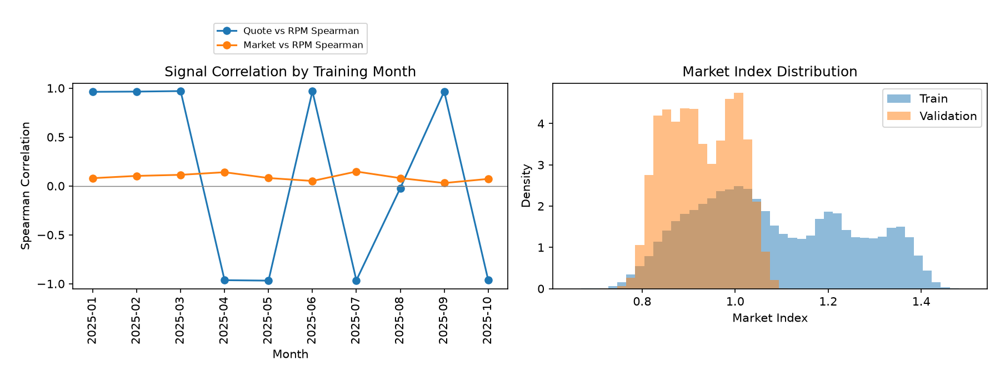
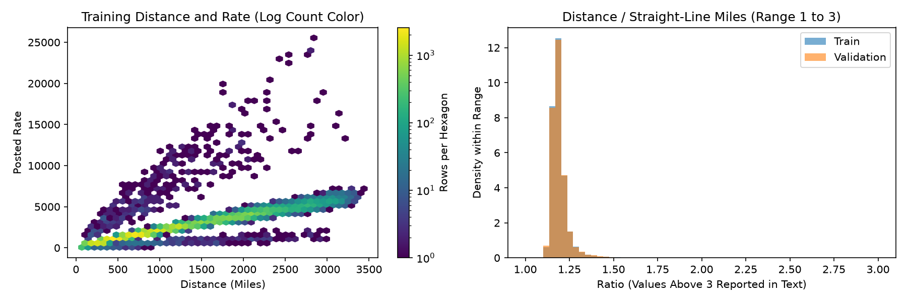

# Freight Rate EDA Findings

Computed from the three supplied CSV files. Source files are read only. Tables describe the raw data unless a subset is named. RPM means posted_rate divided by positive distance. Correlations use available pairs. Rates use the source's units; distances are treated as miles for the coordinate check.

## Shape and Completeness

Train has 48,000 rows and 14 columns, 0 duplicate full rows and 0 duplicate load_ids (extra occurrences). Dates span 2025-01-01 to 2025-10-31.

Validation has 12,000 rows and 13 columns, 0 duplicate full rows and 0 duplicate load_ids (extra occurrences). Dates span 2025-11-01 to 2025-12-31.

| index | Train dtype | Train missing | Validation dtype | Validation missing |
| --- | --- | --- | --- | --- |
| date | object | 0 | object | 0 |
| delivery | object | 0 | object | 0 |
| delivery_lat | float64 | 0 | float64 | 0 |
| delivery_lon | float64 | 0 | float64 | 0 |
| distance | float64 | 0 | float64 | 0 |
| equipment | object | 0 | object | 0 |
| load_id | object | 0 | object | 0 |
| market_index | float64 | 374 | float64 | 249 |
| pickup | object | 0 | object | 0 |
| pickup_lat | float64 | 0 | float64 | 0 |
| pickup_lon | float64 | 0 | float64 | 0 |
| posted_rate | float64 | 0 | absent | absent |
| quote_signal | float64 | 0 | float64 | 0 |
| weight | float64 | 300 | float64 | 165 |

Shared load_ids between datasets: 0. Dates are object strings in the CSV and parsed for this analysis. Validation has no posted_rate column, so its prediction error and target correlations cannot be measured.

Reproduce from the worktree with the supplied Python environment:

```powershell
& D:\Assessments\Spotter\freight-rate\.venv\Scripts\python.exe src/eda.py --data-dir D:\Assessments\Spotter\freight-rate\data
```

The default --data-dir is data. The script writes this report and four aggregate figures under reports/.

## Time Coverage and Validation

| month | Train rows | Validation rows |
| --- | --- | --- |
| 2025-01 | 4918 | 0 |
| 2025-02 | 4337 | 0 |
| 2025-03 | 5036 | 0 |
| 2025-04 | 4819 | 0 |
| 2025-05 | 4913 | 0 |
| 2025-06 | 4783 | 0 |
| 2025-07 | 4912 | 0 |
| 2025-08 | 4759 | 0 |
| 2025-09 | 4670 | 0 |
| 2025-10 | 4853 | 0 |
| 2025-11 | 0 | 5836 |
| 2025-12 | 0 | 6164 |

Use dates through 2025-08-31 for fitting (38,477 rows), 2025-09-01 to 2025-09-30 for tuning (4,670), and 2025-10-01 to 2025-10-31 as the untouched final holdout (4,853). Also test a two-month forecast: fit through 2025-08-31 and evaluate September plus October (9,523 rows), matching the two future months in the supplied validation set. After selection, refit through 2025-10-31. Fit imputers, clipping thresholds and encoders inside each fitting window.

A seeded 80/20 random split gives 38,400/9,600 rows, with 10 months in fitting and 10 in testing. It puts 7,621 September/October rows into fitting. Only 42 random-test rows have unseen directed lanes, versus 21 in the two-month time holdout. This lets the model learn the same months and signal regimes it is tested on. It risks optimistic future performance; no model-score improvement is claimed by this EDA.

The time holdout has fewer unseen-lane rows than the random holdout in this sample, so lane novelty is not the reason to prefer it. The future-month boundary is. Freeze model choices before examining October or the combined September/October result.



## Target and Feature Relationships

| index | count | mean | std | min | 1% | 5% | 25% | 50% | 75% | 95% | 99% | max |
| --- | --- | --- | --- | --- | --- | --- | --- | --- | --- | --- | --- | --- |
| posted_rate | 48,000 | 2,373.9807 | 1,486.4932 | 57.2200 | 327.1688 | 599.7385 | 1,251.5550 | 2,030.7600 | 3,330.7500 | 4,953.7665 | 5,972.8340 | 25,533 |
| rate_per_mile | 48,000 | 2.2153 | 0.5839 | 0.3337 | 1.6735 | 1.8075 | 1.9870 | 2.1453 | 2.3427 | 2.7359 | 3.1769 | 14.1253 |

For posted_rate, the 1.5-IQR fences are -1,867.2375 and 6,449.5425; 260 rows fall outside them. These are review flags, not proof of bad labels.

For rate_per_mile, the 1.5-IQR fences are 1.4534 and 2.8763; 1,634 rows fall outside them. These are review flags, not proof of bad labels.

Target zeros: 0; negative targets: 0; skewness: 1.9024. RPM zeros: 0; negative RPM: 0.

| index | posted_rate pearson | posted_rate spearman | rate_per_mile pearson | rate_per_mile spearman |
| --- | --- | --- | --- | --- |
| distance | 0.9085 | 0.9760 | -0.3346 | -0.7357 |
| weight | 0.0348 | 0.0417 | 0.0745 | 0.1961 |
| market_index | 0.0342 | 0.0315 | 0.0835 | 0.1798 |
| quote_signal | -0.0399 | -0.0399 | 0.0493 | 0.0911 |

These are marginal associations, not causal effects. Weight correlations above include recorded negative weights.

Using only 47,408 positive-weight rows, weight Pearson correlation is 0.0417 with rate and 0.0932 with RPM.

| equipment | rows | mean_rate | median_rate | mean_rpm | median_rpm |
| --- | --- | --- | --- | --- | --- |
| Dry Van | 27202 | 2,271.5487 | 1,953.0350 | 2.1154 | 2.0462 |
| Flatbed | 8753 | 2,445.0872 | 2,076.8100 | 2.2947 | 2.2197 |
| Reefer | 12045 | 2,553.6369 | 2,196.6700 | 2.3834 | 2.3115 |

| month | rows | mean_rate | median_rate | mean_rpm | median_rpm |
| --- | --- | --- | --- | --- | --- |
| 2025-01 | 4918 | 2,255.9670 | 1,915.2000 | 2.1002 | 2.0292 |
| 2025-02 | 4337 | 2,273.8048 | 1,994.2500 | 2.1229 | 2.0611 |
| 2025-03 | 5036 | 2,372.2681 | 2,022.9200 | 2.2061 | 2.1393 |
| 2025-04 | 4819 | 2,372.1623 | 2,044.2400 | 2.2103 | 2.1467 |
| 2025-05 | 4913 | 2,421.7763 | 2,065.5100 | 2.2601 | 2.1902 |
| 2025-06 | 4783 | 2,497.0301 | 2,120.2200 | 2.3325 | 2.2479 |
| 2025-07 | 4912 | 2,415.1620 | 2,059.1450 | 2.2560 | 2.1874 |
| 2025-08 | 4759 | 2,338.4077 | 2,015.7300 | 2.1886 | 2.1205 |
| 2025-09 | 4670 | 2,406.3740 | 2,057.1300 | 2.2297 | 2.1596 |
| 2025-10 | 4853 | 2,379.0514 | 2,035.9000 | 2.2398 | 2.1638 |

Distance is strongly associated with total rate (Pearson 0.9085), while longer loads have lower RPM (Spearman -0.7357). Median RPM is 2.0462 for Dry Van, 2.2197 for Flatbed and 2.3115 for Reefer. Equipment comparisons are not adjusted for lane or month.



## Signal Strength and Stability

| index | Rows | Market vs rate Pearson | Market vs RPM Pearson | Market vs RPM Spearman | Quote vs rate Pearson | Quote vs RPM Pearson | Quote vs RPM Spearman | Median abs quote minus RPM |
| --- | --- | --- | --- | --- | --- | --- | --- | --- |
| All train | 48,000 | 0.0342 | 0.0835 | 0.1798 | -0.0399 | 0.0493 | 0.0911 | 0.0423 |

| month | Rows | Market vs rate Pearson | Market vs RPM Pearson | Market vs RPM Spearman | Quote vs rate Pearson | Quote vs RPM Pearson | Quote vs RPM Spearman | Median abs quote minus RPM |
| --- | --- | --- | --- | --- | --- | --- | --- | --- |
| 2025-01 | 4,918 | 0.0131 | 0.0358 | 0.0797 | -0.5999 | 0.4467 | 0.9625 | 0.0149 |
| 2025-02 | 4,337 | 0.0066 | 0.0352 | 0.1030 | -0.6388 | 0.4790 | 0.9650 | 0.0150 |
| 2025-03 | 5,036 | 0.0124 | 0.0582 | 0.1139 | -0.5952 | 0.4858 | 0.9701 | 0.0151 |
| 2025-04 | 4,819 | 0.0322 | 0.0738 | 0.1405 | 0.6128 | -0.4717 | -0.9634 | 0.3222 |
| 2025-05 | 4,913 | 0.0008 | 0.0380 | 0.0813 | 0.6238 | -0.4592 | -0.9679 | 0.3411 |
| 2025-06 | 4,783 | 0.0076 | 0.0270 | 0.0512 | -0.5801 | 0.4766 | 0.9681 | 0.0152 |
| 2025-07 | 4,912 | 0.0371 | 0.0695 | 0.1474 | 0.6030 | -0.4683 | -0.9646 | 0.3435 |
| 2025-08 | 4,759 | 0.0027 | 0.0323 | 0.0802 | 0.0148 | -0.0136 | -0.0224 | 0.2331 |
| 2025-09 | 4,670 | 0.0114 | 0.0189 | 0.0300 | -0.5913 | 0.4814 | 0.9665 | 0.0154 |
| 2025-10 | 4,853 | 0.0353 | 0.0564 | 0.0720 | 0.6053 | -0.4340 | -0.9593 | 0.3292 |

In 5 of 10 training months (2025-01, 2025-02, 2025-03, 2025-06, 2025-09), median absolute quote_signal minus RPM is 0.0149 to 0.0154, or 0.69% to 0.72% of the overall median RPM (2.1453). Monthly Spearman correlations in those months are 0.9625 to 0.9701. This near-copy relationship is strong evidence that quote_signal is target-derived in those months, rather than merely correlated with RPM. This is an inference from the values, not verified feature provenance. Treat quote_signal as a leak unless provenance proves it predates the quote; scores using it are not credible evidence of deployable prediction quality without that proof.

The 4 strongly negative months (2025-04, 2025-05, 2025-07, 2025-10) have median absolute gaps of 0.3222 to 0.3435 and Spearman correlations of -0.9679 to -0.9593, consistent with a mirrored target transform. August Spearman is -0.0224, consistent with noise. Market-to-RPM monthly Pearson correlation ranges from 0.0189 to 0.0738. Report the signal-free model as the headline and require pre-quote provenance for either signal before considering it for deployment.

| Dataset | Feature | count | mean | std | min | 1% | 5% | 25% | 50% | 75% | 95% | 99% | max |
| --- | --- | --- | --- | --- | --- | --- | --- | --- | --- | --- | --- | --- | --- |
| Train | market_index | 47,626 | 1.0834 | 0.1681 | 0.6764 | 0.7829 | 0.8363 | 0.9497 | 1.0558 | 1.2196 | 1.3660 | 1.4072 | 1.4678 |
| Train | quote_signal | 48,000 | 2.0625 | 0.2914 | 0.6923 | 1.3047 | 1.6061 | 1.8910 | 2.0558 | 2.2217 | 2.5508 | 2.8840 | 3.6103 |
| Validation | market_index | 11,751 | 0.9269 | 0.0741 | 0.7236 | 0.7910 | 0.8145 | 0.8639 | 0.9229 | 0.9924 | 1.0409 | 1.0658 | 1.0990 |
| Validation | quote_signal | 12,000 | 2.0513 | 0.2198 | 1.2348 | 1.5422 | 1.6917 | 1.9035 | 2.0512 | 2.2000 | 2.4137 | 2.5641 | 2.8963 |

| dataset | month | market_index | quote_signal |
| --- | --- | --- | --- |
| Train | 2025-01 | 0.9267 | 2.0684 |
| Train | 2025-02 | 0.9960 | 2.0971 |
| Train | 2025-03 | 1.0729 | 2.1795 |
| Train | 2025-04 | 1.2076 | 1.9634 |
| Train | 2025-05 | 1.3015 | 1.9128 |
| Train | 2025-06 | 1.2803 | 2.2960 |
| Train | 2025-07 | 1.2009 | 1.9230 |
| Train | 2025-08 | 0.9815 | 2.0522 |
| Train | 2025-09 | 0.8930 | 2.1998 |
| Train | 2025-10 | 0.9575 | 1.9428 |
| Validation | 2025-11 | 0.9187 | 2.0553 |
| Validation | 2025-12 | 0.9347 | 2.0476 |

market_index: validation mean shift is -0.9309 training standard deviations; validation/train standard deviation ratio is 0.4409. There are 0 observed validation values outside the training min/max. Missingness is 0.78% in train and 2.08% in validation. The distribution differs materially. Staying inside the training min/max does not rule out a shift in its center or spread.

quote_signal: validation mean shift is -0.0382 training standard deviations; validation/train standard deviation ratio is 0.7543. There are 0 observed validation values outside the training min/max. Missingness is 0.00% in train and 0.00% in validation. The mean is similar, but the spread is lower. Similar marginal values do not establish stable target relationships, since validation has no labels.

Market index is not a very strong marginal signal in this data: pooled RPM Pearson is 0.0835. Quote is very strong within most months by rank, but August Spearman is -0.0224. A single stable quote-to-price rule is not supported by these month-level results.



## Data Quality and Suggested Handling

| index | Train | Validation |
| --- | --- | --- |
| Invalid dates | 0 | 0 |
| Nonfinite numeric cells (excluding missing) | 0 | 0 |
| Missing weight | 300 | 165 |
| Negative weight | 292 | 145 |
| Zero weight | 0 | 0 |
| Missing market_index | 374 | 249 |
| Nonpositive distance | 0 | 0 |
| Invalid latitude/longitude rows | 0 | 0 |
| Zero straight-line distance | 0 | 0 |
| Distance below straight-line miles | 0 | 0 |
| Distance above 3x straight-line miles | 12 | 11 |
| Cities | 64 | 72 |
| Cities with multiple coordinate pairs | 0 | 0 |
| Coordinate pairs with multiple names | 0 | 0 |
| Extra names differing only in case/space | 0 | 0 |

The nonfinite check scans the same 8 shared raw numeric columns in each dataset: pickup_lat, pickup_lon, delivery_lat, delivery_lon, distance, weight, market_index, quote_signal. Missing values are counted separately; the target and derived columns are excluded from this comparison.

Across both files, 0 city names map to multiple coordinate pairs. The check finds internal consistency only; it does not establish that coordinates match real cities. Case/space checks cannot detect arbitrary misspellings. No external geocoding was used.

| index | Train distance / air miles | Validation distance / air miles |
| --- | --- | --- |
| count | 48,000 | 12,000 |
| mean | 1.1947 | 1.2179 |
| std | 0.1435 | 1.2426 |
| min | 1.0581 | 1.0988 |
| 25% | 1.1648 | 1.1650 |
| 50% | 1.1822 | 1.1822 |
| 75% | 1.2048 | 1.2054 |
| max | 9.6350 | 78.5007 |

Straight-line distance uses the haversine formula with Earth radius 3,958.7613 miles. A road distance above three times straight-line distance is a screening threshold, not an impossible route. Check routing and units before replacing it.



| Issue | Train rows | Validation rows | Suggested Handling |
| --- | --- | --- | --- |
| Missing weight | 300 | 165 | Flag and impute from fitting-window equipment medians, with a global fallback. |
| Negative weight | 292 | 145 | Flag, set to missing in model input and impute. Do not assume absolute value is correct. |
| Missing market_index | 374 | 249 | Flag and impute using fitting-window values, or exclude in the signal-free model. |
| Distance above 3x air miles | 12 | 11 | Flag for route review. Keep supplied distance until a correction is verified. |
| Rate outside 1.5-IQR fences | 260 | No target | Flag and inspect with lane, equipment and RPM. Compare robust loss or log target; do not drop by price alone. |
| RPM outside 1.5-IQR fences | 1634 | No target | Flag and compare sensitivity. If clipping helps a time holdout, learn bounds within its fitting window. |

Issue counts can overlap. Keep all validation rows for final prediction. No source values were changed, no rows were dropped and no clipping was applied in this EDA.

## Lane and Equipment Coverage

A lane is the ordered (pickup, delivery) pair; its reverse is a different lane. Counts below distinguish unique categories from affected rows.

| index | Train unique | Validation unique | Seen unique | Unseen unique | Seen rows | Unseen rows |
| --- | --- | --- | --- | --- | --- | --- |
| Directed city lane | 4014 | 4214 | 3478 | 736 | 10539 | 1461 |
| Equipment | 3 | 3 | 3 | 0 | 12000 | 0 |
| Directed lane + equipment | 10793 | 7246 | 5837 | 1409 | 10148 | 1852 |

Validation has 8 cities absent from train: Allentown, Charlotte, Chicago, Jackson, Knoxville, Laredo, Norfolk, San Diego. They affect 1,447 rows. Unseen lanes also include new combinations of known cities.

| equipment | Train rows | Validation rows |
| --- | --- | --- |
| Dry Van | 27202 | 6780 |
| Reefer | 12045 | 3051 |
| Flatbed | 8753 | 2169 |

## December Chart Inputs

The chart file has 31 rows and 7 columns. Its dates run from 2025-12-01 to 2025-12-31, with 31 distinct dates. predicted_rate has 31 blank placeholders. The missing training feature columns are load_id, pickup_lat, pickup_lon, delivery_lat, delivery_lon, market_index, quote_signal.

| index | pickup | delivery | distance | equipment | weight |
| --- | --- | --- | --- | --- | --- |
| 0 | Lexington | Fort Wayne | 360 | Dry Van | 32000 |

| city | lat | lon |
| --- | --- | --- |
| Lexington | 36.9915 | -84.9988 |
| Fort Wayne | 41.3156 | -85.3621 |

The 1 December directed lane(s) have 32 training rows, including 21 rows matching chart equipment. Train supplies 2 coordinate mappings for 2 required cities. This permits an internal lookup, subject to the coordinate-consistency limitation above.

Neither market_index nor quote_signal is supplied for any of the 31 chart rows. Use a separate model trained and time-validated without those two features, using the six supplied inputs and train-derived coordinates. Do not invent future signals or copy validation signals from other loads. Validate this exact missing-signal setting before refitting. A chart may be flat if selected features do not support day-to-day changes; the input alone supplies no daily market observations.

## Recommended Plan

1. Fit 38,477 rows through August, tune on 4,670 September rows, then test once on 4,853 October rows; also assess the combined two-month horizon.

2. Use distance, equipment, positive/imputed weight, directed cities, coordinates and calendar features. Exclude load_id; the two files share zero IDs.

3. Compare a training median baseline and equipment RPM-times-distance baseline; distance has rate Pearson correlation 0.9085.

4. Compare Ridge with encoded categories against HistGradientBoostingRegressor; select by time-holdout MAE and RMSE, including seen/unseen-lane slices.

5. Report the signal-free model as the headline. Treat quote_signal as a leak unless provenance proves it predates the quote; monthly RPM Spearman spans -0.9679 to 0.9701. Keep signal ablations diagnostic, with market-only deployment conditional on provenance and time validation.

6. For all 31 December dates, use the separately validated signal-free model and the 2 train coordinate mappings; refit selected models through October.
